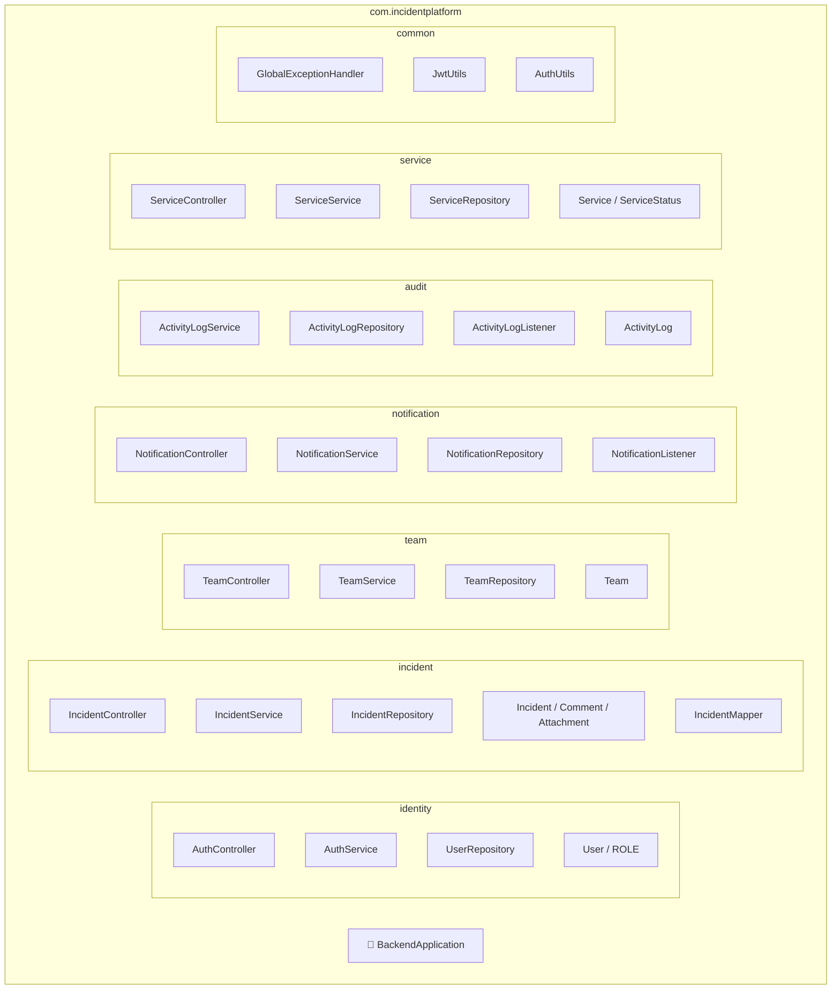
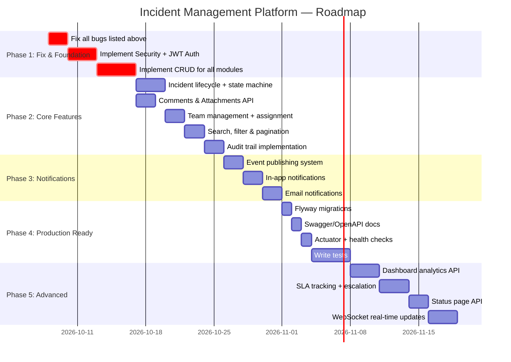
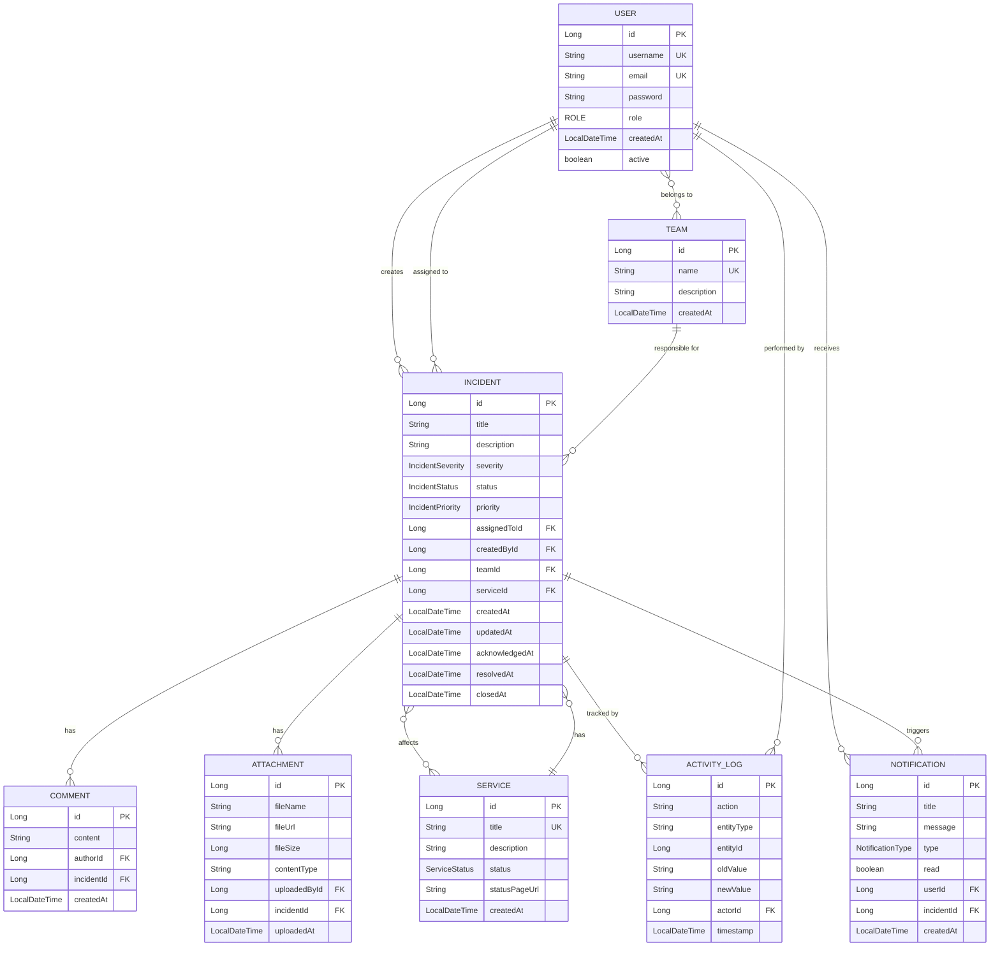

# 🔍 Incident Management Platform — Backend Analysis

## 📐 Architecture Overview

**Stack:** Spring Boot 4.1.1 · Java 21 · PostgreSQL · Lombok · Docker  
**Pattern:** Modular monolith with layered architecture (Controller → Service → Repository)



---

## ✅ What's Good

| Area | Detail |
|------|--------|
| **Modular package structure** | Clean separation into `identity`, `incident`, `team`, `notification`, `audit`, `service`, `common` — this is a solid foundation for a modular monolith |
| **Layered architecture** | Consistent Controller → Service → Repository pattern across all modules |
| **DTO + Mapper pattern** | You're separating entities from API contracts — great for API stability |
| **Event-driven hooks** | Listeners in `notification` and `audit` show you're thinking about decoupled event handling |
| **Lifecycle callbacks** | `@PrePersist` / `@PreUpdate` for automatic timestamp management |
| **Enums for status/severity** | `IncidentStatus`, `IncidentSeverity`, `ServiceStatus`, `ROLE` — type-safe domain modeling |
| **Global exception handler** | Centralized error response format with `@RestControllerAdvice` |
| **Docker support** | Dockerfile with multi-stage build + compose.yaml for Postgres |
| **Validation starter** | `spring-boot-starter-validation` included — ready for `@Valid` annotations |
| **ActivityLog audit trail** | Having a dedicated audit module from the start is forward-thinking |

---

## 🐛 Bugs & Critical Issues

### 1. ❌ `application.yaml` — Username/Password SWAPPED
```yaml
# CURRENT (WRONG)
password: @{POSTGRES_USER:postgres}    # ← This is the USERNAME variable
username: @{POSTGRES_PASSWORD}         # ← This is the PASSWORD variable

# CORRECT
username: ${POSTGRES_USER:postgres}
password: ${POSTGRES_PASSWORD:@@abdo@@}
```
Also: Spring uses `${}` syntax, not `@{}`.

### 2. ❌ `compose.yaml` vs `.env` — Credentials MISMATCH
```yaml
# compose.yaml says:
POSTGRES_DB=mydatabase
POSTGRES_USER=myuser
POSTGRES_PASSWORD=secret

# .env says:
POSTGRES_DB: incidents_platform
POSTGRES_USER: postgres
POSTGRES_PASSWORD: "@@abdo@@"
```
These need to be unified. The app will fail to connect.

### 3. ❌ `UserRepository` — Wrong import
```java
// CURRENT (WRONG) — imports Tomcat's User, not yours
import org.apache.catalina.User;

// CORRECT
import com.incidentplatform.identity.entity.User;
```

### 4. ❌ `ServiceRepository` — Wrong entity type
```java
// CURRENT (WRONG) — references Notification entity
public interface ServiceRepository extends JpaRepository<Notification, Long> {}

// CORRECT
public interface ServiceRepository extends JpaRepository<Service, Long> {}
```

### 5. ❌ `IncidentMapper.toDTO()` — Wrong return type & logic
```java
// CURRENT: Returns Incident instead of IncidentDTO
public Incident toDTO(Incident incident) {
    IncidentDTO incidentDTO = new IncidentDTO();
    // ... populates DTO but returns original incident
    return incident;  // ← Bug: should return incidentDTO
}

// CORRECT
public IncidentDTO toDTO(Incident incident) {
    IncidentDTO incidentDTO = new IncidentDTO();
    // ... populate
    return incidentDTO;
}
```

### 6. ❌ `IncidentController` — Wrong annotation
```java
// CURRENT (WRONG) — passing path to @RestController (sets bean name, not URL)
@RestController("/api/incidents")

// CORRECT
@RestController
@RequestMapping("/api/incidents")
```

### 7. ❌ `Incident.attachments` — Wrong type mapping
```java
// CURRENT (WRONG) — declared as Set<Comment>, should be Set<Attachment>
@OneToMany(mappedBy = "incident", orphanRemoval = true, fetch = FetchType.LAZY)
private Set<Comment> attachments;

// CORRECT
@OneToMany(mappedBy = "incident", orphanRemoval = true, fetch = FetchType.LAZY)
private Set<Attachment> attachments;
```

### 8. ❌ `Dockerfile` — Missing `FROM` on second stage
```dockerfile
# CURRENT (WRONG)
RUN eclipse-temurin:21-jre-alpine

# CORRECT
FROM eclipse-temurin:21-jre-alpine
```

### 9. ❌ `Notification` entity — Empty class, not even `@Entity`
The `Notification` entity is completely empty — no JPA annotations, no fields. The `NotificationRepository` extends `JpaRepository<Notification, Long>` which will fail at startup.

### 10. ❌ `ServiceDTO` — Annotated with `@Service` instead of being a POJO
```java
// CURRENT (WRONG)
@Service
public class ServiceDTO {}

// CORRECT — should be a data class
@Data @NoArgsConstructor @AllArgsConstructor
public class ServiceDTO {
    private String title;
    private String description;
    private ServiceStatus status;
}
```

### 11. ⚠️ `User.createdAt` — Stored as `String` instead of `LocalDateTime`
```java
// CURRENT
private String createdAt;
// prePersist: this.createdAt = LocalDateTime.now().toString();

// BETTER
private LocalDateTime createdAt;
```

### 12. ⚠️ `ActivityLog` — Missing `action` field
The audit log tracks WHO and WHICH incident but not WHAT action was performed. It also lacks `oldValue`/`newValue` for meaningful audit trails.

---

## 🗑️ What Should Be Removed / Fixed

| Item | Reason |
|------|--------|
| **`common/config/`** (empty dir) | Remove empty placeholder directories — add them when needed |
| **`common/security/`** (empty dir) | Same as above |
| **`incident/event/`** (empty dir) | Same |
| **`@Service` on `ServiceDTO`** | DTOs shouldn't be Spring beans |
| **DEBUG logging level** | `org.springframework: DEBUG` and `org.hibernate: DEBUG` in production config is too verbose — use profiles |
| **`@Data` on JPA entities** | Lombok `@Data` generates `equals()`/`hashCode()` using all fields including lazy-loaded collections. This causes `LazyInitializationException` and infinite loops. Use `@Getter`/`@Setter` + manual `equals`/`hashCode` on `@Id` only. |
| **`NotificationService`** | Missing `@Service` annotation — won't be a Spring bean |

---

## 🏗️ What Should Be Added

### Priority 1 — Core Functionality (Your code won't work without these)

| Feature | Details |
|---------|---------|
| **Security config** | `SecurityFilterChain` bean — currently Spring Security blocks ALL endpoints by default. You need a `SecurityConfig` class in `common/security/` |
| **JWT implementation** | `JwtUtils` and `AuthUtils` are empty shells. Implement token generation, validation, and a `JwtAuthenticationFilter` |
| **Auth endpoints** | Register (`POST /api/auth/register`) and Login (`POST /api/auth/login`) endpoints with password hashing (`BCryptPasswordEncoder`) |
| **CRUD operations** | All controllers and services are empty — implement at minimum: Create, Read (single + list), Update, Delete for Incidents, Teams, and Services |
| **`UserDetailsService` impl** | Spring Security needs this to load user data during authentication |
| **CORS configuration** | If you have a frontend, you'll need `@CrossOrigin` or a `WebMvcConfigurer` bean |
| **JWT dependency** | Add `io.jsonwebtoken:jjwt-api`, `jjwt-impl`, `jjwt-jackson` to `pom.xml` |

### Priority 2 — Essential Features

| Feature | Details |
|---------|---------|
| **Incident ↔ Service relationship** | Incidents should be linked to affected Services (`@ManyToOne` or `@ManyToMany`) |
| **Incident ↔ Team assignment** | Assign incidents to Teams, not just individual Users |
| **Comment author** | `Comment` entity needs a `User author` field + `LocalDateTime createdAt` |
| **Attachment metadata** | `Attachment` needs `fileName`, `fileUrl`, `fileSize`, `contentType`, `uploadedBy`, `uploadedAt` |
| **Pagination & sorting** | Use `Pageable` in repository methods and controller params for list endpoints |
| **Search & filtering** | Filter incidents by status, severity, assignee, date range — use `JpaSpecificationExecutor` |
| **Request/Response DTOs** | Separate `CreateIncidentRequest`, `UpdateIncidentRequest`, `IncidentResponse` — don't use one DTO for everything |
| **Validation annotations** | Use `@NotBlank`, `@NotNull`, `@Size`, `@Email` etc. on request DTOs |
| **API versioning** | Prefix all endpoints with `/api/v1/` |

### Priority 3 — Production Readiness

| Feature | Details |
|---------|---------|
| **Flyway/Liquibase** | Database migrations instead of `ddl-auto: update` (dangerous in production) |
| **Application profiles** | `application-dev.yaml`, `application-prod.yaml` — separate configs for dev/prod |
| **Actuator** | Add `spring-boot-starter-actuator` for health checks, metrics, and monitoring |
| **OpenAPI/Swagger** | Add `springdoc-openapi-starter-webmvc-ui` for API documentation |
| **Rate limiting** | Protect public endpoints with `bucket4j` or similar |
| **Email integration** | `spring-boot-starter-mail` for notification delivery |
| **WebSocket/SSE** | Real-time incident updates pushed to the frontend |
| **File storage** | S3/MinIO integration for attachment uploads |
| **Caching** | Redis/Caffeine for frequently accessed data (incident counts, service status) |
| **Tests** | Unit tests for services, integration tests for controllers — the test directory is empty |

---

## 📋 Feature Roadmap



---

## 🧭 Recommended Entity Relationship (Target State)



---

## 📊 Summary Scorecard

| Category | Score | Note |
|----------|-------|------|
| **Package Structure** | ⭐⭐⭐⭐ | Well-organized modular design |
| **Entity Design** | ⭐⭐ | Good start but has bugs and missing fields/relationships |
| **Security** | ⭐ | Dependencies present but zero implementation |
| **Business Logic** | ⭐ | All services and controllers are empty shells |
| **Error Handling** | ⭐⭐ | Good foundation but only handles one exception type |
| **Configuration** | ⭐ | Bugs in yaml, env mismatch, no profiles |
| **Docker** | ⭐⭐ | Good multi-stage idea but has `FROM` → `RUN` bug |
| **Tests** | ⭐ | None written |
| **Overall** | ⭐⭐ / 5 | **Solid skeleton with a clear vision, but needs all the muscle built on top** |

---

## 🚀 Platform Features — Complete Feature List

### 1. 🔐 Identity & Authentication

| # | Feature | Description |
|---|---------|-------------|
| 1.1 | **User Registration** | `POST /api/v1/auth/register` — Create a new account with username, email, and password. Passwords hashed with `BCryptPasswordEncoder`. |
| 1.2 | **User Login** | `POST /api/v1/auth/login` — Authenticate with credentials and receive a JWT access token (+ optional refresh token). |
| 1.3 | **JWT Token Management** | Generate, validate, and refresh JSON Web Tokens. Includes token expiration, refresh rotation, and blacklisting on logout. |
| 1.4 | **Role-Based Access Control (RBAC)** | Three roles — `VIEWER` (read-only), `USER` (create/manage own incidents), `ADMIN` (full platform control). Enforce via `@PreAuthorize` or custom filters. |
| 1.5 | **User Profile Management** | `GET/PUT /api/v1/users/me` — View and update own profile (display name, email, avatar). |
| 1.6 | **User Administration** | `GET/PUT/DELETE /api/v1/users/{id}` — Admin-only endpoints to list, update roles, activate/deactivate, and delete user accounts. |
| 1.7 | **Password Reset** | `POST /api/v1/auth/forgot-password` and `/reset-password` — Token-based password reset flow via email. |
| 1.8 | **Session Management** | `POST /api/v1/auth/logout` — Invalidate tokens. Optional: track active sessions per user. |

### 2. 🔥 Incident Management (Core Module)

| # | Feature | Description |
|---|---------|-------------|
| 2.1 | **Create Incident** | `POST /api/v1/incidents` — Report a new incident with title, description, severity (`LOW`, `MEDIUM`, `HIGH`, `CRITICAL`), and optionally assign to a user/team/service. |
| 2.2 | **View Incident** | `GET /api/v1/incidents/{id}` — Retrieve full incident details including comments, attachments, timeline, and assignment info. |
| 2.3 | **List Incidents** | `GET /api/v1/incidents` — Paginated, sortable list of all incidents. Supports filtering by status, severity, assignee, team, service, and date range. |
| 2.4 | **Update Incident** | `PUT /api/v1/incidents/{id}` — Modify incident fields (title, description, severity, assignment). |
| 2.5 | **Incident Lifecycle / State Machine** | Enforce valid status transitions: `OPEN` → `ACKNOWLEDGED` → `INVESTIGATING` → `RESOLVED` → `CLOSED`. Auto-record timestamps (`acknowledgedAt`, `resolvedAt`, `closedAt`) on each transition. |
| 2.6 | **Assign Incident** | `PUT /api/v1/incidents/{id}/assign` — Assign/reassign an incident to a specific user or team. Triggers notification to the assignee. |
| 2.7 | **Incident Comments** | `POST/GET /api/v1/incidents/{id}/comments` — Add timestamped comments with author tracking. Supports edit and delete of own comments. |
| 2.8 | **Incident Attachments** | `POST/GET/DELETE /api/v1/incidents/{id}/attachments` — Upload files (screenshots, logs, documents) with metadata: `fileName`, `fileUrl`, `fileSize`, `contentType`, `uploadedBy`, `uploadedAt`. |
| 2.9 | **Incident Search & Filtering** | Full-text search on title/description. Filter by status, severity, assignee, team, service, date range. Powered by `JpaSpecificationExecutor`. |
| 2.10 | **Incident Priority** | Separate `IncidentPriority` enum (`P1`, `P2`, `P3`, `P4`) in addition to severity, allowing priority-based triage and SLA assignment. |
| 2.11 | **Incident Tags / Labels** | `ManyToMany` relationship with a `Tag` entity — flexible categorization (e.g., `network`, `database`, `security`, `deployment`). |
| 2.12 | **Incident Timeline** | Aggregated chronological view of all status changes, comments, assignments, and attachments for a single incident. |
| 2.13 | **Bulk Operations** | `PUT /api/v1/incidents/bulk` — Bulk update status, assign, or close multiple incidents at once. |
| 2.14 | **Incident Duplication / Linking** | Mark incidents as duplicates or link related incidents together (`@ManyToMany` self-referencing relationship). |
| 2.15 | **Delete / Archive Incident** | Soft-delete incidents (set `archived = true`) rather than hard-delete, preserving audit trail. Admin-only hard delete. |

### 3. 👥 Team Management

| # | Feature | Description |
|---|---------|-------------|
| 3.1 | **Create Team** | `POST /api/v1/teams` — Create a new team with name and description. |
| 3.2 | **View Team** | `GET /api/v1/teams/{id}` — Retrieve team details including member list. |
| 3.3 | **List Teams** | `GET /api/v1/teams` — Paginated list of all teams with member counts. |
| 3.4 | **Update Team** | `PUT /api/v1/teams/{id}` — Modify team name, description. |
| 3.5 | **Delete Team** | `DELETE /api/v1/teams/{id}` — Remove a team (reassign its incidents first). |
| 3.6 | **Manage Team Members** | `POST/DELETE /api/v1/teams/{id}/members` — Add or remove users from a team. Users can belong to multiple teams (`@ManyToMany`). |
| 3.7 | **Team Incident Dashboard** | `GET /api/v1/teams/{id}/incidents` — List all incidents assigned to a specific team, with status breakdown. |
| 3.8 | **On-Call Scheduling** | Define on-call rotations per team — who is the primary responder at any given time. Auto-assign new incidents to the on-call user. |

### 4. 🛠️ Service Management

| # | Feature | Description |
|---|---------|-------------|
| 4.1 | **Register Service** | `POST /api/v1/services` — Register a monitored service/component with title, description, and initial status. |
| 4.2 | **View Service** | `GET /api/v1/services/{id}` — Service details with current status and linked active incidents. |
| 4.3 | **List Services** | `GET /api/v1/services` — All services with their current operational status. |
| 4.4 | **Update Service** | `PUT /api/v1/services/{id}` — Modify service details and status (`OPERATIONAL`, `DEGRADED`, `DOWN`). |
| 4.5 | **Delete Service** | `DELETE /api/v1/services/{id}` — Deregister a service. |
| 4.6 | **Service ↔ Incident Linking** | `@ManyToMany` or `@ManyToOne` relationship — associate incidents with affected services. Automatically degrade service status when critical incidents are opened. |
| 4.7 | **Service Health History** | Track status changes over time with timestamps — enables uptime percentage calculations. |
| 4.8 | **Public Status Page API** | `GET /api/v1/status` — Public (unauthenticated) endpoint returning current status of all services, designed for a frontend status page. |
| 4.9 | **Service Dependencies** | Model service-to-service dependencies — when a core service is `DOWN`, flag dependent services as at-risk. |

### 5. 🔔 Notification System

| # | Feature | Description |
|---|---------|-------------|
| 5.1 | **In-App Notifications** | Persistent notifications stored in the `Notification` entity — with `title`, `message`, `type`, `read` status, linked to a `User` and optionally an `Incident`. |
| 5.2 | **List Notifications** | `GET /api/v1/notifications` — Paginated list of current user's notifications (unread first). |
| 5.3 | **Mark as Read** | `PUT /api/v1/notifications/{id}/read` and `PUT /api/v1/notifications/read-all` — Mark individual or all notifications as read. |
| 5.4 | **Event-Driven Notification Triggers** | Automatically generate notifications on: incident creation, status change, assignment, new comment, approaching SLA breach. Powered by Spring Application Events + `NotificationListener`. |
| 5.5 | **Email Notifications** | `spring-boot-starter-mail` integration — send email alerts for critical incidents, assignment changes, and SLA breaches. Configurable per-user email preferences. |
| 5.6 | **Real-Time Push (WebSocket / SSE)** | WebSocket or Server-Sent Events for live updates — push incident status changes and new notifications to connected clients without polling. |
| 5.7 | **Notification Preferences** | Per-user settings: choose which events trigger notifications and through which channels (in-app, email, both, none). |
| 5.8 | **Notification Types** | Enum `NotificationType` — `INCIDENT_CREATED`, `INCIDENT_ASSIGNED`, `STATUS_CHANGED`, `COMMENT_ADDED`, `SLA_WARNING`, `SLA_BREACHED`, `SYSTEM_ALERT`. |

### 6. 📝 Audit & Activity Logging

| # | Feature | Description |
|---|---------|-------------|
| 6.1 | **Automatic Activity Logging** | Every significant action (create, update, delete, assign, status change) is recorded via `ActivityLogListener` using Spring Events. |
| 6.2 | **Rich Audit Entries** | Each `ActivityLog` entry captures: `action` performed, `entityType` + `entityId` affected, `oldValue` → `newValue` diff, `actor` (user), and `timestamp`. |
| 6.3 | **View Audit Trail** | `GET /api/v1/audit` — Paginated, filterable audit log. Filter by actor, entity type, action, date range. |
| 6.4 | **Per-Incident Audit Trail** | `GET /api/v1/incidents/{id}/activity` — Full history of all changes to a specific incident. |
| 6.5 | **Per-User Activity** | `GET /api/v1/users/{id}/activity` — View all actions performed by a specific user. |
| 6.6 | **Immutable Log** | Audit entries are append-only — no update or delete endpoints. Ensures tamper-proof compliance records. |

### 7. 📊 Dashboard & Analytics API

| # | Feature | Description |
|---|---------|-------------|
| 7.1 | **Incident Statistics** | `GET /api/v1/dashboard/stats` — Total incidents by status, severity, and priority. Open vs. resolved counts. |
| 7.2 | **Mean Time to Acknowledge (MTTA)** | Average time from `OPEN` → `ACKNOWLEDGED` across all incidents, filterable by time period. |
| 7.3 | **Mean Time to Resolve (MTTR)** | Average time from `OPEN` → `RESOLVED` across all incidents, filterable by team, service, and severity. |
| 7.4 | **Trend Charts Data** | `GET /api/v1/dashboard/trends` — Incident volume over time (daily/weekly/monthly), severity distribution trends. |
| 7.5 | **Team Performance Metrics** | Incidents handled per team, average resolution time per team, workload distribution. |
| 7.6 | **Service Uptime Metrics** | Per-service uptime percentage, incident count, and time-in-degraded-state. |
| 7.7 | **SLA Compliance Report** | Percentage of incidents resolved within SLA targets, grouped by priority level. |

### 8. ⚡ SLA & Escalation Engine

| # | Feature | Description |
|---|---------|-------------|
| 8.1 | **SLA Policy Definition** | Define response and resolution time targets per priority level (e.g., P1: respond in 15 min, resolve in 1 hour). |
| 8.2 | **SLA Timer Tracking** | Automatically track elapsed time against SLA targets. Display countdown / overdue status on incidents. |
| 8.3 | **SLA Breach Alerts** | Trigger notifications (in-app + email) when an incident is approaching or has breached its SLA target. |
| 8.4 | **Automatic Escalation** | If an incident remains unacknowledged beyond the SLA response window, auto-escalate: reassign to team lead or next-tier responder, send urgent notifications. |

### 9. 🔧 Platform-Wide / Cross-Cutting Features

| # | Feature | Description |
|---|---------|-------------|
| 9.1 | **Global Exception Handling** | `@RestControllerAdvice` with consistent error response format (`timestamp`, `status`, `message`, `path`). Handles validation errors, not-found, auth failures, etc. |
| 9.2 | **Request Validation** | `@Valid` + Bean Validation annotations (`@NotBlank`, `@NotNull`, `@Size`, `@Email`) on all request DTOs. |
| 9.3 | **Pagination & Sorting** | All list endpoints support `page`, `size`, `sort` query parameters via Spring `Pageable`. |
| 9.4 | **API Versioning** | All endpoints prefixed with `/api/v1/` for forward-compatible evolution. |
| 9.5 | **CORS Configuration** | `WebMvcConfigurer` or `@CrossOrigin` for frontend integration — configurable allowed origins, methods, and headers. |
| 9.6 | **Rate Limiting** | Protect public and authentication endpoints with rate limiting (`bucket4j` or similar) to prevent abuse. |
| 9.7 | **OpenAPI / Swagger Documentation** | `springdoc-openapi-starter-webmvc-ui` — auto-generated interactive API docs at `/swagger-ui.html`. |
| 9.8 | **Health Checks & Monitoring** | `spring-boot-starter-actuator` — `/actuator/health`, `/actuator/metrics`, `/actuator/info` endpoints for operational monitoring. |
| 9.9 | **Database Migrations** | Flyway or Liquibase for version-controlled schema migrations — replace `ddl-auto: update` for production safety. |
| 9.10 | **Application Profiles** | Separate `application-dev.yaml`, `application-staging.yaml`, `application-prod.yaml` with environment-specific configs. |
| 9.11 | **Caching** | Redis or Caffeine caching for frequently accessed data (dashboard stats, service status, user sessions). |
| 9.12 | **File Storage** | S3 / MinIO integration for incident attachment uploads — store files externally, save metadata in DB. |
| 9.13 | **Logging & Observability** | Structured JSON logging, correlation IDs per request, integration-ready for ELK stack or Grafana. |
| 9.14 | **Testing** | Unit tests (services + mappers), integration tests (controllers + repositories), end-to-end API tests. Target: ≥80% coverage. |
| 9.15 | **Docker & Deployment** | Multi-stage Dockerfile, `compose.yaml` for local dev (Postgres + app), CI/CD pipeline ready. |

---

### 📈 Feature Count Summary

| Module | Features |
|--------|----------|
| Identity & Authentication | 8 |
| Incident Management | 15 |
| Team Management | 8 |
| Service Management | 9 |
| Notification System | 8 |
| Audit & Activity Logging | 6 |
| Dashboard & Analytics | 7 |
| SLA & Escalation | 4 |
| Platform-Wide / Cross-Cutting | 15 |
| **Total** | **80** |

> [!IMPORTANT]
> **Bottom line:** You have a well-structured scaffold — the package organization and module separation are genuinely good architectural decisions. But right now it's a skeleton with 12 bugs/issues that need fixing before any of it will even compile and run. Fix the critical bugs first (especially the `application.yaml`, wrong imports, and entity mapping issues), then implement security, then CRUD operations. The roadmap above gives you a phased approach. The 80 features listed above represent the complete vision for what this platform should include when fully built out.
